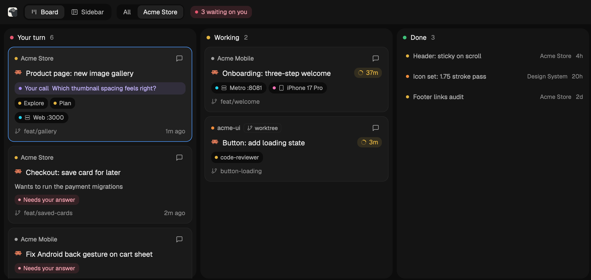
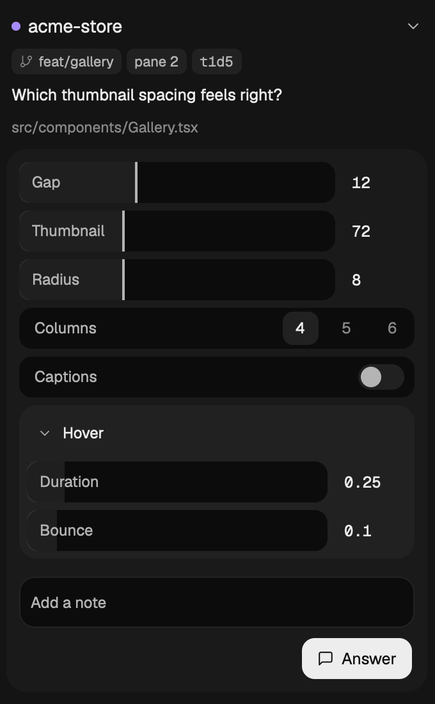
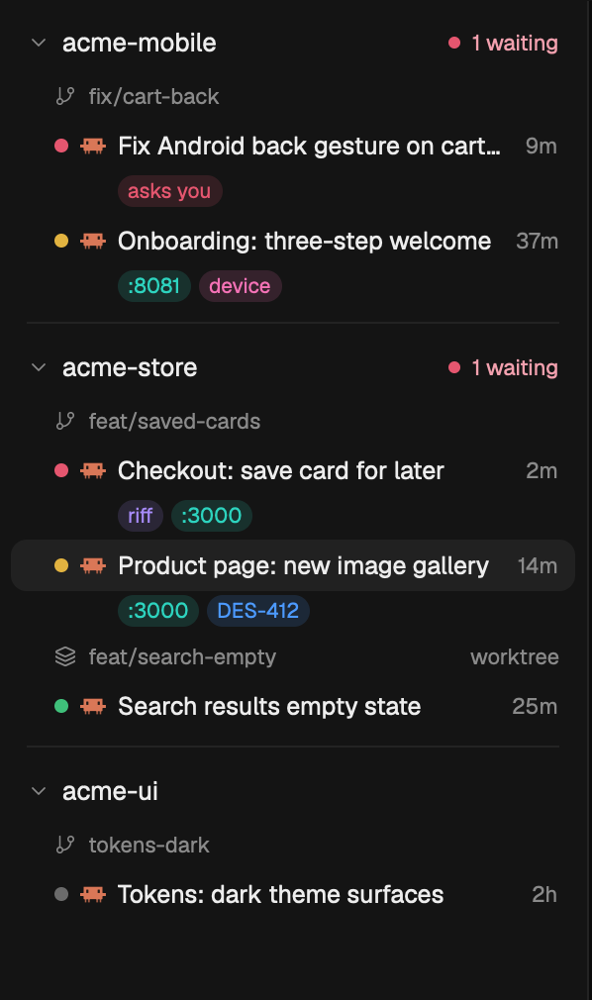
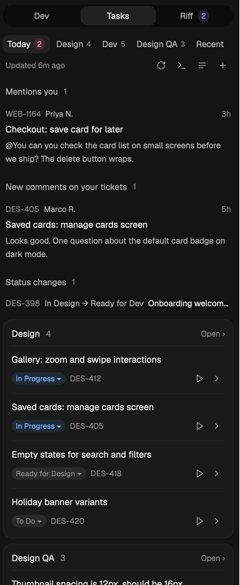

# Herdr agent board



A layout for [Herdr](https://herdr.dev) for working with several coding agents at once. It shows who is waiting on you,
what is running where, and lets an agent ask you a visual question and get your answer back.

- **A board of whose turn it is**: every agent tab is a card, in Your turn, Working or Done.
- **Riffs**: an agent asks a UI question with live controls (sliders, colors, toggles, springs), after
  [DialKit](https://github.com/joshpuckett/dialkit). You drag, and it sees the numbers.
- **A projects sidebar**: repos, branches, sessions and what each has going on.
- **Dev and Tasks panels**: dev servers and simulators; tasks from Jira, GitHub, Linear or your own list.
- **Color-coded markers**, Claude stats in each pane header, and long-term usage and cost stats.

<p>
  
  
  
</p>

Everything in the images is made-up demo data (`herdr-app do kanban.demo`).

## Install

```sh
git clone https://github.com/stalinzbb/herdr-agent-board
cd herdr-agent-board
./install.sh
```

Then, in Claude Code started inside the clone, add this repo as a plugin and run the setup skill:

```
/plugin marketplace add .
/plugin install herdr-agent-board@herdr-agent-board
/herdr-agent-board:setup
```

Setup asks where your tasks come from (Jira, GitHub, Linear, your own list, or several), connects each,
finds your dev servers, and offers to add the Claude session hook. You can skip it and edit the files
below yourself.

Everyone's steps are different, so Jira's tabs can be shaped to yours:

```
/herdr-agent-board:workflow
```

It looks at your recent tickets, asks what kinds of work you track and what each status means to you
(for example "Ready for Dev" is done for a designer, "Won't Do" is hidden), then writes the tabs.

## The board

Every tab is a card. The columns say whose turn it is:

- **Your turn**: the agent asked you something (a permission, a question, a riff), finished, or is waiting
  for a prompt. Questions come first, then work you haven't looked at. Plain terminals are here too.
- **Working**: an agent is working.
- **Done**: tabs you marked done with ✓. They keep running; opening one, or its agent needing you, brings it
  back. ↺ puts it back without opening it.

The project on a card is its git repo. A **worktree** tag means the card works in a second checkout of
that repo on its own branch (from **New → Agent in a new worktree…**, Claude's worktrees, or `git worktree`).
Its changes don't touch your main checkout until you merge.

**Markers.** Each kind of thing a session has is its own color, on the sidebar rows, the board cards, the
rail tabs and the status bar (hover a marker for the specifics, such as the port numbers):

| Color | Means |
|---|---|
| Red | An agent is waiting on your answer |
| Violet | A riff is open |
| Cyan | A dev server is running (the hover lists its ports) |
| Pink | A simulator or device is in use |
| Blue | Tasks (the Tasks tab's count) |
| Amber / green | Working / finished (unchanged) |

**New** in the top bar starts everything: an agent or a terminal in a new tab, an agent in a new worktree,
a split of the pane you're in, or a new project from a folder. Herdr calls a project a *space*; a card is a
*tab*, and a tab holds *panes*.

## The sidebar

**Board | Sidebar** in the top bar (⌘B) swaps the board for a list of the same tabs by project:

- each project (its git repo), with "1 waiting" or "2 working" beside it when that's so; click to fold it
- the branch its tabs are on, as a caption; a second checkout says **worktree**
- one line per tab: a dot for what its agent is doing, its name, how many panes, how long ago it changed
- under a tab, small labels for what it has going on: **riff** (it asked you a UI question; click to open
  it), **asks you**, a port such as **:3000** when a dev server runs in its folder (click to open it),
  **device**, and the ticket key when the tab's name or branch has one that's in progress in Tasks
- a tab with several agents lists them, and running subagents show under their agent

## Where things live

| | |
|---|---|
| This repo | The code. `install.sh` copies it into `~/.config/herdr-app` (Herdr only runs code inside its own folder, so links don't work). |
| `~/.config/herdr-board/` | **Your settings.** Never touched by install or updates. Any file missing here falls back to `mods/kanban/defaults/`. |
| `~/.cache/herdr-kanban/` | Jira results, digest, session map, usage summaries. Safe to delete. |
| `~/.local/share/herdr-kanban/usage.db` | Long-term Claude usage history (SQLite). |

Settings files: `jira.json`, `dev.json`, `prompts.json`, `task-agent.json` (the agent tasks start with,
written by the Tasks panel), `usage.json` (`code_roots`), and optionally
`prices.json` and `models.json` to override API prices and context window sizes. The ✎ button on
each panel opens yours, making it from the default the first time.

## Updating

- From the repo: `git pull && ./install.sh`. An installed copy that differs is backed up first, to
  `~/.config/herdr-board/backup/`.
- Changed something in Herdr directly (or had an agent do it)? `./install.sh --pull` copies it back
  into the repo so you can commit it.

## Tasks panel: sources

`tasks.json` turns sources on; each adds its own tab(s), and Today gathers the open work from all of them.
Every row opens its link, its status pill moves it, and ▶ starts an agent on it in a new tab. The agent is
your default (the terminal icon in the panel's header picks it; it's kept in
`~/.config/herdr-board/task-agent.json`, and with none saved it's the first installed one). The arrow
next to ▶ starts that one task with a different agent. **+** in the header adds a task of your own.

| Source | How it connects | Tab | Status changes |
|---|---|---|---|
| `jira` | Claude's Atlassian connector (`claude -p --model haiku`), settings in `jira.json` | The preset's tabs, plus the morning digest on Today | Jira's workflow |
| `github` | The `gh` CLI you're signed in to | GitHub: Issues (assigned to you), Pull requests (review requests, yours) | Close / reopen issues |
| `linear` | A personal API key in your Keychain (`herdr-board-linear`) or `$LINEAR_API_KEY` | Linear: issues assigned to you | Your team's states |
| `local` | Nothing: `~/.config/herdr-board/tasks.local.json` | No tab: **+** adds a task, or an agent runs `tasks-sync.py add "…"`; they show in Today | To do / Doing / Done |

```json
{ "name": "Tasks",
  "sources": {
    "jira": { "enabled": true },
    "github": { "enabled": true, "issues": "is:open assignee:@me org:acme archived:false" },
    "linear": { "enabled": false },
    "local": { "enabled": true, "label": "Mine" } } }
```

GitHub's `issues`, `closed`, `prs` and `reviews` are GitHub search queries; `recent_days` (14) is how far
back closed work shows. Jira refreshes every `refresh_minutes` in work hours, the others every `fast_minutes`
(5). See what the panel will show: `python3 -I ~/.config/herdr-app/mods/kanban/tasks-sync.py config`.

## Tasks panel: Jira presets

`jira.json` names a preset from `mods/kanban/presets/jira/` and fills its vars:

```json
{
  "site": "https://example.atlassian.net",
  "cloudId": "…",
  "preset": "designer",
  "vars": { "design": "UXD", "dev": "ECOM" }
}
```

| Preset | Tabs | Vars |
|---|---|---|
| `designer` | Today · Design · Dev (features, prototypes) · Design QA · Recent | `design`, `dev` projects; optional `spike_type`, `subtask_types`, `qa_types`, `qa_title`, `design_done`, `design_todo` |
| `engineer` | Today · My work · Review · Bugs · Recent | `projects` (a list); optional `review_statuses`, `bug_type` |
| `mine` | Today · Assigned · Reported · Recent | none |

A list var becomes a quoted JQL list. Any other top-level key you set (`name`, `default_tab`, `views`,
`tabs`, `today_tabs`, `digest_at`, `work_hours`, …) replaces the preset's; `skills/workflow/SKILL.md`
explains each, including `status_map` (`new` / `indeterminate` / `done` / `hide` per status). To see the result:
`python3 -I ~/.config/herdr-app/mods/kanban/jira-sync.py config`.

Jira calls go through `claude -p --model haiku` with only the connector's Jira tools allowed. The
results are read from the tool calls as Jira returned them, so nothing in the panel is written by the
model. If your Atlassian tools have another name, list them under `"tools"` in `jira.json` (see the skill).

## Riff: agents ask you UI questions

When an agent needs your call on something visual (how much spacing, which color, which variant, how
a spring feels), it opens a **riff**: a question with live controls (sliders, colors, toggles,
selects, springs, easings) in the rail's **Riff** tab, next to its pane. You drag, add a note if you
like, and **Answer**. The answer goes straight back to the agent and the riff closes. The card says who
is asking (the project, then chips for the tab, branch, pane and session id) and shows the question
below it. Its caret (or the whole project row) folds the riff to one line, and with several waiting only
the first starts open; **Collapse all** sits above them. Controls are grouped into cards you can fold.

- It's contextual: the Riff tab shows the questions from the tab you're on, the focused pane's first.
  When several agents share a tab, each riff says which pane asks (`<tab> · <branch>`); click it to go
  there. An agent elsewhere that's waiting on you moves to "Your turn" on the board with its question
  on the card, and you get a notification that takes you there. When the tab you're on has no riff,
  the other tabs' riffs show in full, so you can answer from anywhere.
- Agents don't sit waiting: `riff.py ask` waits 20 seconds, then the agent ends its turn and your
  answer arrives in its pane as a message. Its pane shows it's your turn, not that it's working.
- If the agent wrote a live `output` file, your dev server shows each value as you drag.
- If the agent stopped waiting, your answer is typed into it as a `Riff · …` message instead.

Agents learn how from the `riff` skill (`skills/riff/SKILL.md`, in the plugin): they plan the
questions (most impact first, 2 to 8 controls each), run `mods/kanban/riff.py ask` with a question and
DialKit-shaped controls, and get JSON back. The skill covers live previews for web, React Native,
the iOS simulator, Flutter and desktop apps, and short rounds where there's no preview. You can also
just say "riff me the card spacing".

With nothing open, the Riff tab offers a prompt to send: **Ask this agent** on an agent's pane, or one
button per agent in the tab when you're on another pane (a dev server, a simulator). The prompt names
the skill and falls back to `riff.py --help`, so it also works in an agent that started before the
plugin was installed (restart those to load the skill properly).

## What it runs

The mods run programs: `hc` (start dev servers, send prompts), `lsof`, `xcrun simctl`, `adb`, `git`,
`python3` (Jira sync, usage import) and `claude` (Jira, through your connector). They read
`~/.claude/projects/**` for usage stats and pane stats. Changing a ticket's status from the panel
writes to Jira.

## Demo mode

`herdr-app do kanban.demo` fills every panel with made-up data (a fictional "Acme" with cards,
tickets and costs), for screenshots or to try the board before setting anything up. Run it again to
go back. It makes no Jira calls and changes nothing.

## Keys

⌘⇧K board ⇄ classic · ⌘B board ⇄ projects sidebar · ⌘⇧B right panel on/off · ⌘⇧E Dev · ⌘⇧J Tasks · ⌘⇧Y Riff · ⌘⇧U usage stats · ⌘⇧M mute sounds

**Mute** (⌘⇧M, or the speaker in the top bar) turns Herdr's attention sounds off and on. It flips
`sounds.enabled` in `~/.config/herdr-app/settings.json`; notifications still appear, silently.

`herdr-app do kanban.tasks_<tab id>` opens the Tasks panel on a tab (for example `kanban.tasks_dev`),
and can be bound to a key in `keys.json`. `herdr-app do kanban.riff_open` opens Riff (and never closes it).

## Credits

Riff is modeled on [DialKit](https://github.com/joshpuckett/dialkit) by
[Josh Puckett](https://joshpuckett.me) (MIT): its idea of live tuning controls, its control config
format and its slider range rules. Riff is a native Herdr rebuild and contains no DialKit code.
