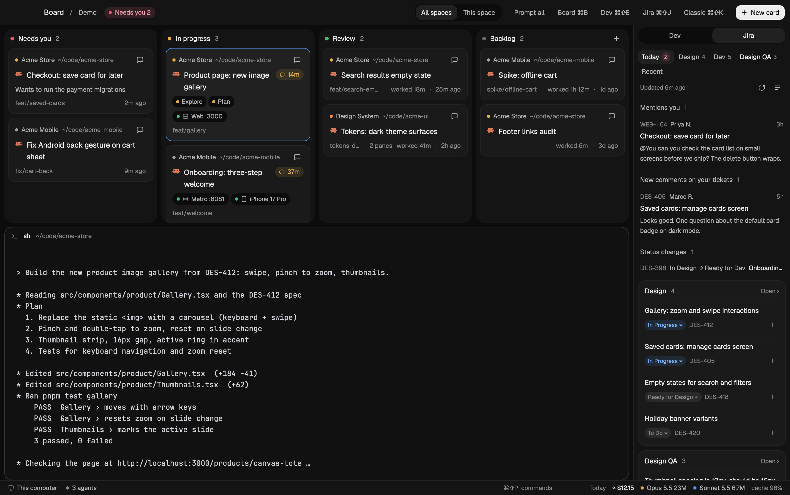

# Board

A flat, dark kanban window for running many coding agents: every tab is a card, sorted into columns by
what its agent is doing, with the focused tab's terminal below and a side rail for dev servers and Jira.

## What you see

- **Bar** (48px, window drag area): "Board / <space>" on the left; a red "Needs you" count; an
  All spaces / This space switch; text buttons Prompt all, Board ⌘B, Dev ⌘⇧E, Jira ⌘⇧J, Classic ⌘⇧K;
  a white "+ New card" button.
- **Board** (weight 2): four rounded columns (radius 16, chrome color): Needs you (red dot), In progress
  (amber), Review (green), Backlog (grey), each with a count. Cards (radius 12, surface color) show a
  project line (hue dot + space name), a wrapping title with the agent's icon, a working timer pill while
  the agent works, sub-agent chips, dev-server/simulator chips, and a meta line (branch, panes,
  "worked Xm · Ym ago").
- **Main tab** below the board: the focused tab's panes, radius 16, with a 34px pane header (mod
  `kanban-pane`) that, for Claude, adds repo · branch · worktree, running subagents, prompt-cache
  countdown, a context bar ("165k / 1M", amber at 70%, red at 90%) and the model name.
- **Rail** (364px, right): a Dev | Jira switch (40px), then:
  - Dev: running servers and simulators/devices first; everything else folded under "Not running".
  - Jira: tabs from the config (Today plus the preset's tabs), "Updated Xm ago", ⟳ and ✎. Today shows
    the digest (mentions, comments, status changes, quiet tickets) and one card per kind of work with
    in-progress and fresh to-dos. Other tabs group by status (In progress, To do with "Show N older",
    Done folded, 5 at a time) or by parent story. Rows are two lines: title, then a status pill (click to
    move the ticket), key, platform tag.
- **Status bar**: Herdr's `workspace-status`, plus a 440px usage widget: "Today ≈ $X · model tokens · cache %".
  Clicking it opens a 900×680 frameless stats window: Today / 7 days / 30 days / All time, KPIs, a
  tokens|cost chart by model, by model, by project, most expensive sessions, hours, subagents.

Theme: graphite with background #111111, canvas #0c0c0c, chrome #141414, surface #1a1a1a,
raised #212121, border #232323, text #ededed / #b4b4b4 / #8a8a8a, accent #4c9aff; status colors
working #e2b340, blocked #e5566f, done #3fc07a, idle #6b6b6b. Sentence case, 4px grid, borders or
shadows never both, color only for status and data.

## How it behaves

- Columns: blocked → Needs you; working → In progress; done → Review; idle → Backlog. Clicking a card
  selects its tab. The timer counts from when the agent started working.
- ⌘B toggles the board, ⌘⇧K switches to Herdr's classic layout and back, ⌘⇧E/⌘⇧J open the rail on
  Dev/Jira, ⌘⇧U opens usage stats. Esc or × closes the stats window.
- Dev: start/stop a configured server (runs in a background Herdr terminal named `dev-<id>`), reload
  Metro, boot simulators; a crashed server notifies.
- `kanban.demo` toggles demo mode (shared `kanban.demo`): `demo.js` supplies made-up cards, Jira
  data and usage, and the pane header shows a placeholder folder. `preview.png` is taken in it.
- Jira: refreshes every 30 minutes in weekday work hours; the digest runs once a day after `digest_at`
  and notifies.

## Built from

- `layouts/kanban.json`: column [bar block (role bar) · row [column [board block (role board), main tab
  block] · column [rail-tabs (role railtabs) · stack dev (role rail) / jira (role jira)]] · status row
  [workspace-status, usage block (role usage)]].
- `mods/kanban` routes by `props().role`: `board.js`, `rail.js`, `railtabs.js`, `jira.js`, `jstatus.js`
  (status popup), `prompts.js` (popup), `usage.js` (widget + stats window), `ui.js`, `pill.js`.
- Herdr API: spaces, panes, terminals, agents, run, exec, readTextFile, watchFolder, openOverlay,
  closeOverlay, shared/setShared, notify, theme.
- Programs: `hc run/send/ls`, `lsof`, `xcrun simctl`, `xctrace`, `adb`, `emulator`, `git`, `curl`
  (Metro reload), `python3` (`jira-sync.py`, `usage.py`), `claude -p --model haiku` with only the
  Atlassian connector's Jira tools allowed.
- Settings: `~/.config/herdr-board/*.json` over `mods/kanban/defaults/*.json`; Jira presets in
  `mods/kanban/presets/jira/` with `{{var}}` placeholders, resolved by `jira-sync.py config`.
- Claude Code `SessionStart` hook (`claude-session-hook.py`) maps `HC_TERMINAL_ID` → session transcript.

## Watch out

- Rounded corners don't clip children in GPUI: give cards inner padding and round the rows, or hover
  backgrounds bleed past the corners.
- `line_height(n)` is a multiplier, not px. Scroll containers need an `id`.
- Herdr won't load mod code through symlinks; install by copying.
- Big Jira results come back as "saved to <path>": read that file.
- The two Atlassian connectors take different `responseContentFormat` values; ask for markdown and
  detect mentions by accountId or "@Name".
- Costs are estimates at API list prices from `prices.json`, not your bill.
